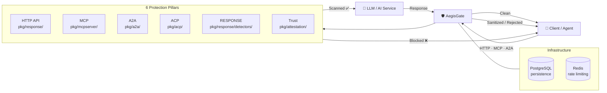

<div align="center">

# 🛡️ AegisGate Security Platform

**Secure every AI interaction. Six pillars. One gateway. Zero external dependencies.**

*A self-hosted gateway that scans every request and response between your team and any AI service — catching data leaks, prompt injections, and compliance violations before they happen.*

[](https://github.com/aegisgatesecurity/aegisgate-platform)
**Found AegisGate useful? [Star the repo](https://github.com/aegisgatesecurity/aegisgate-platform) ⭐ and [tell a colleague](https://x.com/intent/tweet?text=Securing%20every%20AI%20interaction%20with%20AegisGate%20%E2%80%94%206%20pillars%2C%201%20gateway%2C%20zero%20dependencies%3A%20https%3A%2F%2Fgithub.com%2Faegisgatesecurity%2Faegisgate-platform) — it helps other teams discover AI security tooling.**

[](https://github.com/aegisgatesecurity/aegisgate-platform/releases/tag/v4.9.0)
[](LICENSE)
[](https://golang.org/)
[](https://github.com/aegisgatesecurity/aegisgate-platform/actions)
[](https://github.com/aegisgatesecurity/aegisgate-platform/actions)
[](docs/compliance/eu-ai-act.md)
[](https://github.com/aegisgatesecurity/aegisgate-platform#ip-notice)
[](https://papers.ssrn.com/sol3/papers.cfm?abstract_id=7652138)
[](#tier-gated-features)
[](#tier-gated-features)
[](https://github.com/aegisgatesecurity/aegisgate-lens)
[](https://github.com/aegisgatesecurity/aegisgate-platform/actions/workflows/ci.yml)
[](https://github.com/aegisgatesecurity/aegisgate-platform/actions/workflows/security.yml)
[](./SECURITY.md)

[🌐 Website](https://aegisgatesecurity.io) · [🚀 Live Demo](https://demo.aegisgatesecurity.io/) · [📊 Pricing](https://aegisgatesecurity.io/pricing/) · [📚 Docs](https://aegisgatesecurity.io/docs/) · [🔒 Security](SECURITY.md) · [💬 Discussions](https://github.com/aegisgatesecurity/aegisgate-platform/discussions)


</div>

> **We follow [GitHub's recommended security practices](https://securitylab.github.com/resources/five-easy-steps-to-secure-your-open-source-project/) for open source projects.** CodeQL scanning · Secret scanning with push protection · Dependabot alerts & security updates · Protected branches · RFC 9116 security policy · [Report a vulnerability →](./SECURITY.md)

---

> **🧩 Using AI without enterprise protections?** [AegisGate Lens](https://github.com/aegisgatesecurity/aegisgate-lens) is our free browser extension that brings detection patterns to everyday AI conversations — for the 95% of users who don't have a security gateway. [Install Lens →](https://github.com/aegisgatesecurity/aegisgate-lens)

> **⚡ Building AI apps with Copilot, Cursor, or Claude Code?** [AegisGate Rampart](https://github.com/aegisgatesecurity/aegisgate-rampart) is our free local proxy that intercepts AI API calls in real-time — for developers who need protection before production. [Download Rampart →](https://github.com/aegisgatesecurity/aegisgate-rampart/releases/tag/v0.7.1)

---

## What is AegisGate Platform?

AegisGate Platform is an **enterprise AI security gateway**. It sits between your organization's users, agents, and applications — and any AI service they talk to. Every request and response is scanned for security threats, compliance violations, and adversarial attacks.

Think of it as a security checkpoint for AI traffic. When someone on your team sends a prompt to ChatGPT, an MCP agent talks to an external tool, or an A2A agent escalates across a trust boundary — Platform scans it first. If it detects a leaked API key, a prompt injection, or a compliance violation, it blocks the request before it ever reaches the AI provider.

One binary. Zero external dependencies. Fail-closed by default.

### Who is it for?

- **Security teams** who need to enforce AI usage policies across the organization
- **Compliance officers** who need audit trails for HIPAA, GDPR, EU AI Act, FedRAMP, and 27 other frameworks
- **DevOps teams** who need to integrate AI security into CI/CD, SIEM, and SOAR pipelines
- **CISOs** who need visibility into what data employees are sending to AI tools — and proof for auditors

## Why AegisGate?

Every AI interaction is an attack surface. Prompt injections leak secrets. MCP servers exfiltrate context. A2A agents escalate privileges across trust boundaries. A single misconfigured LLM response can expose PII, violate compliance, or hand an attacker a credential.

AegisGate sits in front of all of it — one binary, zero dependencies, fail-closed by default — so you don't have to worry about what your team is sending to AI services.

- **Zero-cost proxy.** -2.8ms p99 overhead (faster than direct). Blocked requests resolve in 7.2ms p50. 23,578 RPS with 0% errors at 5,000 VUs.
- **Fail-closed.** If AegisGate can't scan a response, it blocks it. No silent failures, no pass-through on error.
- **Self-hosted.** No API keys to rotate, no third-party to trust. Your data stays in your infrastructure.
- **6 pillars, one gateway.** HTTP, MCP, A2A, ACP, Response, and Trust — no patchwork of point products.
- **303 canonical detection patterns.** Secrets, XSS, PII, and compliance — wired into every response, every time. The same engine powers Lens and Rampart.
- **30+ compliance frameworks.** From community basics (OWASP LLM, ATLAS, NIST AI RMF) to enterprise certifications (FedRAMP, HITRUST, TISAX, CMMC L2).

## Security Posture

| Metric | Value |
|--------|-------|
| CVEs | **0** |
| Fail-closed by default | ✅ |
| TRACE/CONNECT/TRACK blocked | ✅ |
| Security headers (CSP, CORP, COEP, COOP, HSTS) | ✅ |
| Private keys in git | **0** (rotated, gitignored, pre-commit blocked) |
| Code-scanning alerts open | **0** |
| Dependabot alerts open | **0** |
| IOC gossip rate limiting | ✅ (60/min/IP default, CIDR allow-list bypass) |
| IOC admin API bearer token auth | ✅ (defense-in-depth, `crypto/subtle`) |
| IOC keyring encryption at rest | ✅ (AES-256-GCM) |
| IOC soft quarantine | ✅ (low-reputation sources stored, not acted upon) |

## Quick Start

### 30-Second Quickstart (Guided Setup)

```bash
# Build the binary
go build -o aegisgate-platform ./cmd/aegisgate-platform/

# Generate a config file automatically (detects your environment)
./aegisgate-platform setup --non-interactive

# Start the platform
./aegisgate-platform --config aegisgate-platform.yaml --embedded-mcp
```

The setup wizard auto-detects Docker, Kubernetes, systemd, or bare metal; recommends a deploy profile; generates a validated config; and prints next steps. No YAML editing required.

### Deploy Profiles

Instead of writing a config from scratch, use one of 5 predefined profiles:

| Profile | TLS | Rate Limit | Use Case |
|---------|-----|-----------|----------|
| `quickstart` | Off | 60 RPM | Zero-config evaluation |
| `small-team` | Auto-gen | 300 RPM | 5-50 users |
| `production` | 1.3 (bring certs) | 1,000 RPM | Hardened production |
| `high-security` | mTLS + FIPS | 5,000 RPM | Regulated industries |
| `air-gapped` | 1.3 (bring certs) | 1,000 RPM | Isolated networks |

```bash
# List all profiles
./aegisgate-platform --profile list

# Run with a profile
./aegisgate-platform --profile quickstart --embedded-mcp

# Generate a config from a profile
./aegisgate-platform setup --profile production --output my-config.yaml
```

<details>
<summary><strong>⚙️ Configuration & Maintenance Commands</strong></summary>

### Config Validation

```bash
# Validate before deploying
./aegisgate-platform config validate aegisgate-platform.yaml

# Show effective config
./aegisgate-platform config show --format json
```

### Maintenance Windows

```bash
# Enable maintenance mode (returns 503 with Retry-After)
./aegisgate-platform maintenance enable --message "Security update"

# Schedule a future window
./aegisgate-platform maintenance schedule --start "2026-09-01T02:00:00Z" --end "2026-09-01T04:00:00Z" --reason "Quarterly patch"

# Disable
./aegisgate-platform maintenance disable
```

### Other Quick Starts

```bash
# Run with defaults (in-memory stores)
./aegisgate-platform --embedded-mcp

# Run with a specific config file
./aegisgate-platform --config configs/enterprise.yaml --embedded-mcp

# Integration tests
go test -tags=integration -timeout 300s ./tests/integration/...
```

</details>

## Request Flow



## 6 Pillars

| Pillar | Package | Description |
|--------|---------|-------------|
| HTTP API | `pkg/response/` | Request/response scanning, PII redaction, secret masking |
| MCP | `pkg/mcpserver/` | Model Context Protocol guardrails, tool poisoning detection (34 dangerous function patterns) |
| A2A | `pkg/a2a/` | Agent-to-Agent protocol security |
| ACP | `pkg/acp/` | Agent Capability Policy enforcement |
| Response | `pkg/response/detectors/` | 216-pattern detection (secrets, XSS, PII, compliance) |
| Trust Framework | `pkg/attestation/` | Cryptographic attestation, CISO posture digest (Professional+: full trust scoring) |

## Detection Engine

The `pkg/response/detectors/` package provides 216 regex patterns — the same detection engine that powers Lens and Rampart:

The `pkg/contracts` package defines canonical pattern and event contracts for cross-product interoperability. Platform serves patterns to FOSS products (Scanner, MCP, Rampart, Lens) via the telemetry endpoint (`GET /api/v1/patterns/latest`) with ETag caching.

| Category | Patterns | What it catches |
|----------|----------|-----------------|
| **Secrets** | 45 | AWS keys, GitHub PATs, Stripe keys, JWTs, GitLab tokens, Twilio, SendGrid, private keys |
| **XSS** | 12 | `<script>`, event handlers, `javascript:`, SVG-based, encoded variants |
| **PII (US Core)** | 15 | SSN, phone, DOB, MRN, ZIP+4, full names with context |
| **PII (Extended)** | 13 | Email, IP addresses, passport numbers, driver's licenses |
| **PII (International)** | 9 | National IDs (NHS, SIN, TFN, IRD, BSN, CF, SSN-IT, NRIC, MyNumber) |
| **PII (Financial)** | 24 | Credit cards, IBANs, SWIFT/BIC, routing numbers |
| **Compliance** | 35 | GDPR data types, HIPAA PHI indicators, PCI-DSS card data, CCPA personal info |

```go
import "github.com/aegisgatesecurity/aegisgate-platform/pkg/response/detectors"

// Scan all 216 patterns
matches := detectors.DetectAll(text)

// Scan by category
secrets := detectors.DetectSecrets(text)
xss := detectors.DetectXSS(text)
pii := detectors.DetectPIIUSCore(text)
compliance := detectors.DetectCompliance(text)

// Wired into ResponseGuard (default: enabled)
guard := response.NewResponseGuard()
result, _ := guard.Scan(ctx, text)
// result.DetectedXSS, result.DetectedCompliance, result.DetectedPII, result.DetectedSecrets
```

## Open-Core Model

AegisGate is **open-core**: the community edition is Apache 2.0 open source, and enterprise features are proprietary.

| Edition | License | Features |
|---------|---------|----------|

| **Community** (free) | Apache 2.0 | HTTP/MCP/A2A/ACP/Response scanning, 303 canonical detection patterns, 4 community compliance frameworks, in-memory + file persistence |
=
